# Grimoire Linux

**Grimoire Linux — a black & white toolkit for KDE Plasma 6: customize every screen, a crosshair overlay for games,
a file manager that tidies itself, a system monitor, a terminal and more, in one sleek app.**

[](LICENSE)
[](https://kde.org/plasma-desktop/)
[](#does-it-work-on-x11-or-gnome)
[](https://doc.qt.io/qtforpython-6/)
[](https://github.com/cookedaj/grimoire-linux/releases/latest)
[](https://github.com/cookedaj/grimoire-linux/stargazers)


```bash
git clone https://github.com/cookedaj/grimoire-linux.git && cd grimoire-linux && ./install.sh
```

No sudo, no telemetry, uninstalls cleanly. Made for Kubuntu and any KDE Plasma 6 desktop on Wayland.

## Why

Ricing and tuning a Plasma desktop usually means a dozen apps, a dozen looks and a lot of config files. Grimoire
Linux puts the tools you reach for every day into one monochrome app with one design language: a slim icon rail,
line icons, no accent colors. Each tool (a "spell") stays out of your way, changes things the way KDE itself would,
and can undo every change it makes. Anything that needs root says so and asks first.

## Spells

### MuraL: KDE Plasma customization


Customize everything you look at: desktop wallpaper with crossfading playlists (images and video), lock screen,
splash, login (SDDM), boot (Plymouth), taskbar, Plasma style, window title bars, motion and effects, colors, icons,
fonts, cursor and terminal. Every tab has live previews, saved **Looks** switch the whole desktop at once, and a
**Community** view lists the top 100 from the KDE Store and Wallhaven, installable in one click.

### SightsL: crosshair overlay for Linux games


A crosshair drawn above every window and fullscreen game (KDE layer-shell), fully click-through and pixel-sharp.
Presets, saved crosshairs and share codes, rotation, outline, offsets, screen choice, live updates, and global
hotkeys: Ctrl+Alt+X hides it, Ctrl+Alt+Shift+X flips to the next one. It draws an overlay; it never touches a game.

### VaultL: a file manager that tidies itself


Places and drives, breadcrumbs, a thumbnail grid or details list, a preview panel, Trash with restore,
KDE-compatible copy/cut/paste and Dolphin's keyboard shortcuts. Its **Tidy** section keeps `~/Downloads` sorted by
type in the background, sends stale installers and archives to the Trash, and finds big files and duplicates.
Never deletes: everything goes to the Trash and every move can be undone. Can be your default file manager.

### OptimizeL: speed tweaks as switches


Scans the PC and lays out speed tweaks as on/off switches: power, memory (zram, earlyoom), storage and boot,
network (BBR), services, startup apps, desktop and gaming. Each one says what it changes, what you gain and what it
risks; one-click plans (Recommended, Max performance, Restore everything) and before/after benchmarks. Switches
survive restarts, and turning one off puts back exactly what was there.

### SystemL: a Linux system monitor


In place of KDE System Monitor: live graphs for CPU (every core), memory, swap, disk, network, GPU, temperatures
and load; a process list with search, tree view, end/force quit and priority; per-app history (what was busy an
hour, a day or a week ago); systemd services with start/stop/logs; startup apps; disks; and background alerts when
memory, temperatures, free space or a stuck app cross the line you set, even while SystemL is closed.

### TerminalL: a black & white terminal


Your shell on a real PTY, in tabs that split side by side or top and bottom. Full 16/256/true color when programs
ask for it, Unicode and wide characters, mouse support for htop and vim, scrollback with search, zoom, profiles,
a palette of saved commands (Ctrl+Shift+P), and new tabs right in VaultL's folder.

### ShotL: screenshots and screen recording


Region, window or whole-screen screenshots, a black & white editor to mark them up, screen recording (H.264 on
the graphics card when it can), and a gallery of every shot. Bind `grimoire-shotl region|window|full|record` to
any key.

### FocusL: a focus timer


Focus in rounds with breaks. While you focus: Do Not Disturb, no crosshair, and the apps and sites you pick kept
away; then your streak, today, this week and the last 14 days. It keeps running when you close the window.

### NetL: network monitor and quick controls


Live download/upload per interface and per app (from the kernel's own TCP counters, no root), connections with
host names, addresses, gateway and DNS, Wi-Fi scan and connect, Wi-Fi/airplane/VPN switches, and daily and monthly
usage. Public IP and ping checks only run when you press them.

### LaunchL: a Plasma app launcher

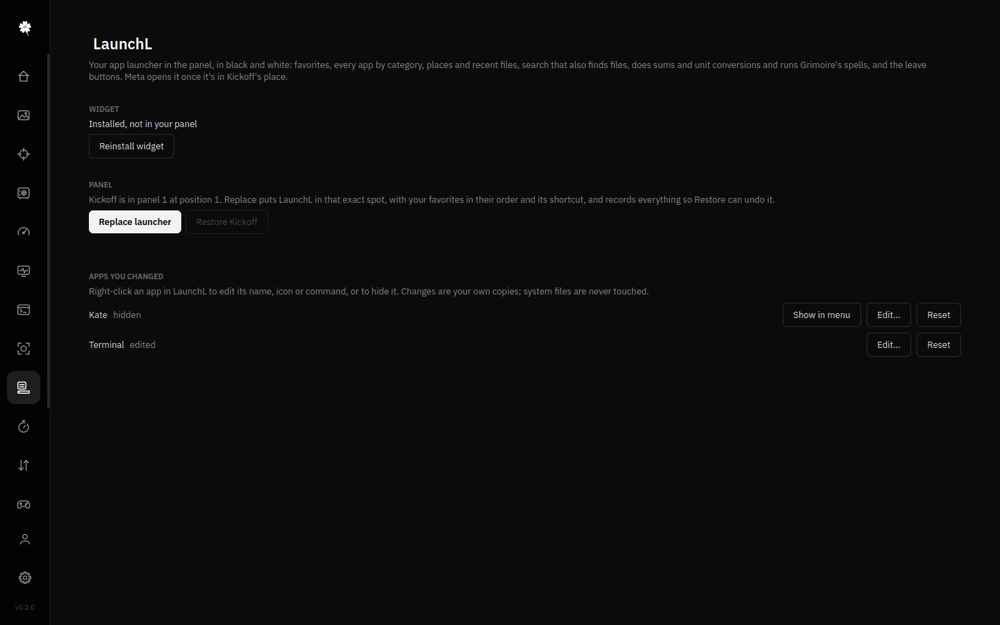

A black & white panel launcher in Kickoff's place: favorites, every app by category, places and recent files,
search that also finds files, does sums and unit conversions and runs Grimoire's spells, plus the leave buttons.
Type a sum (`12*7+3`, `2^10`, `sqrt(2)`, `15% of 80`) and the answer is the top result; Enter copies it. Right-click
an app to **Edit…** its name, icon or command, or **Hide from Menu**: changes are your own copy in
`~/.local/share/applications`, system files are never touched, and Reset puts the app back (your copy goes to the Trash).

### GameL: one game library

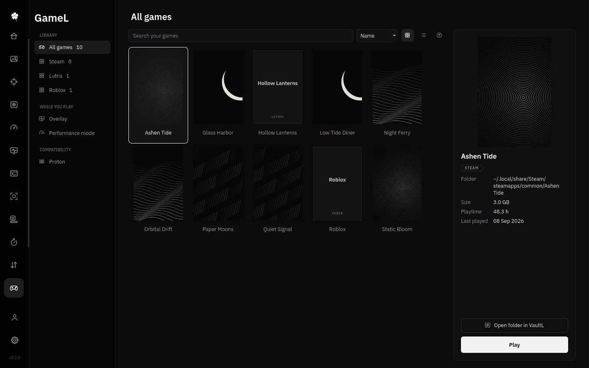

Every game on the PC in one grid of gray covers or a list: Steam (including Flatpak Steam, extra library folders and
your non-Steam shortcuts), Heroic (Epic, GOG, Amazon and sideloaded), Lutris, itch, Bottles, Roblox (Sober to play,
Vinegar for Studio, each with its own tile) and every game in the app menu, native or Flatpak, each listed once.
Search, sort by name, last played, size or playtime, see where a game lives and open its folder in VaultL, and press
Play to start it through its own launcher. A black & white MangoHud overlay (FPS, frame times, CPU/GPU load and
temperature, RAM, VRAM; Shift_R+F12 shows or hides it) and Performance mode sit one click away. Both are manual
switches: starting a game never changes anything else. The Proton panel folds in ProtonUp-Qt: install GE-Proton
releases from GitHub (checksum-verified, only when you click Install), see which games Steam runs on which build,
move old builds to the Trash, and open Protontricks for any Steam game.
Meta opens it. **Replace launcher** records your Kickoff first, so **Restore Kickoff** puts back exactly what was there.

### UpdateL: every update in one place

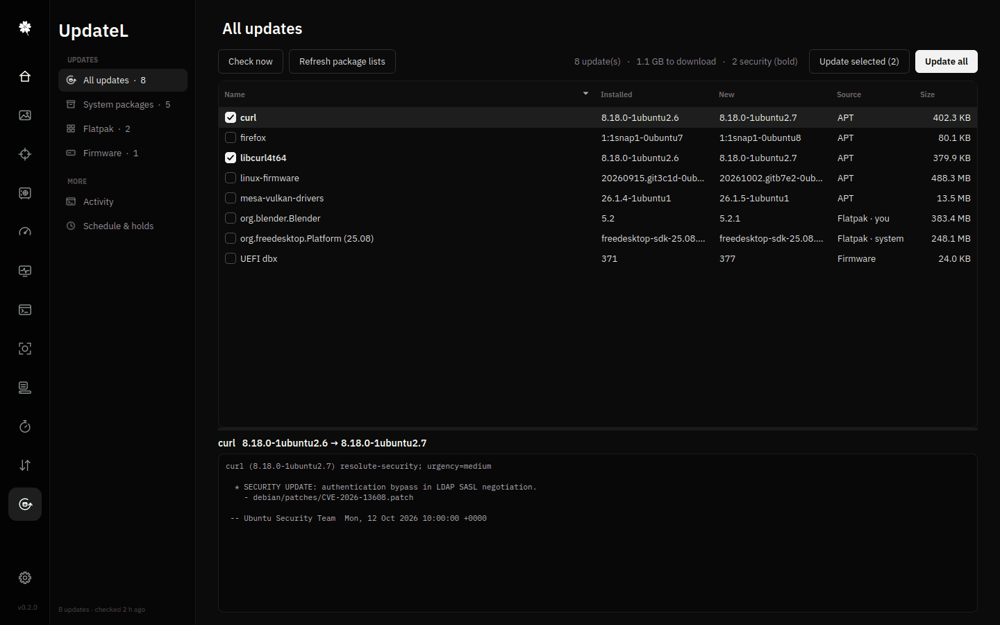

System packages (APT), Flatpaks (yours and the system's), snaps and firmware (fwupd) in one list, each with its
installed and new version, size and what's new (the Debian changelog entries, the Flatpak commit, the firmware's
release notes). Update all, one source or just what you tick; the root part asks for your password once and the log
streams in. Every APT upgrade is simulated first: anything it would remove is listed and needs a tick, and removing
`kubuntu-desktop` or the IBM Plex fonts is refused. It also shows held packages and when a restart is needed, and can
look once a day in the background (never installing) and notify you.
### AudioL: sound on PipeWire

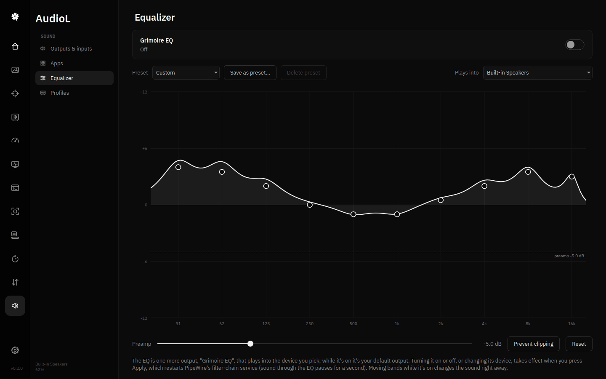

Your outputs and inputs (default device, volume, mute, a live level meter), each app's volume and the device it
plays on, sound card profiles (HDMI or analog, stereo or surround), and a system-wide 10-band equalizer with
presets. The EQ is PipeWire's own filter-chain: one more output, "Grimoire EQ", that plays into the device you pick;
turning it on or off is an explicit **Apply** that restarts only PipeWire's filter-chain service.

### WidgetL: desktop widgets

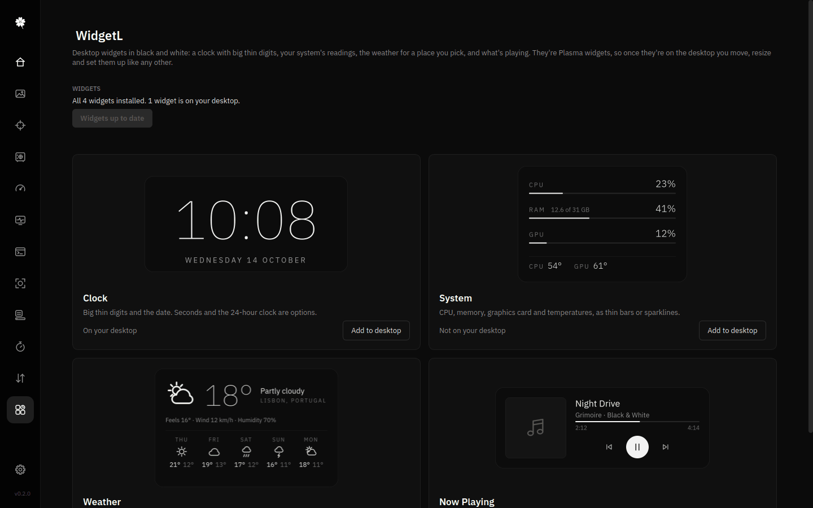

Four Plasma desktop widgets in black and white: a **Clock** with big thin digits and the date (seconds and the
24-hour clock optional), **System** with CPU, memory, graphics card and temperatures as thin bars or sparklines
(from Plasma's own sensors), **Weather** for a place you search for or type in (Open-Meteo, no account; it never
looks up where you are) with line icons and the next five days, and **Now Playing** for any app that plays music or
video, with the cover in grayscale and the play controls. The page previews each one, installs them and adds them
to your desktop; `grimoire-widgetl add clock|system|weather|nowplaying` does the same from a terminal.

### GlyphL: emoji and symbol picker

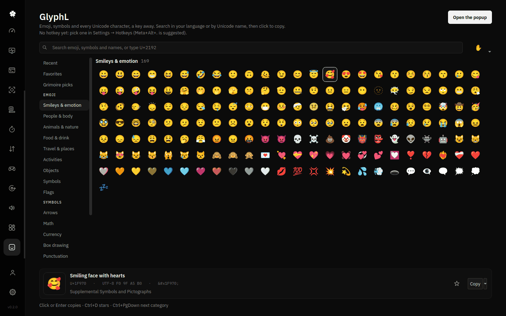

Emoji, symbols and every Unicode character on a hotkey, in place of KCharSelect and Plasma's emoji picker. Search
by name or keyword in your language (Plasma's own CLDR emoji dictionaries) or in English, by Unicode name, or type a
code point (`U+2192`, `&rarr;`); browse emoji groups, arrows, math, currency, box drawing, Latin, Greek and Cyrillic,
Grimoire's black & white picks, or any Unicode block. A skin tone for people and hands, recent and starred
characters, and an info pane with the code point, UTF-8 bytes and HTML entity. Click or Enter copies it and closes the
popup, so Ctrl+V pastes it: KDE on Wayland doesn't let an app type into another app's window, so GlyphL can't paste
for you. `grimoire-glyphl` shows or hides the popup; bind it in **Settings → Hotkeys** (Meta+Alt+. is suggested,
since Meta+. is Plasma's emoji selector).
### CloudL: Google Drive, OneDrive and Dropbox as folders

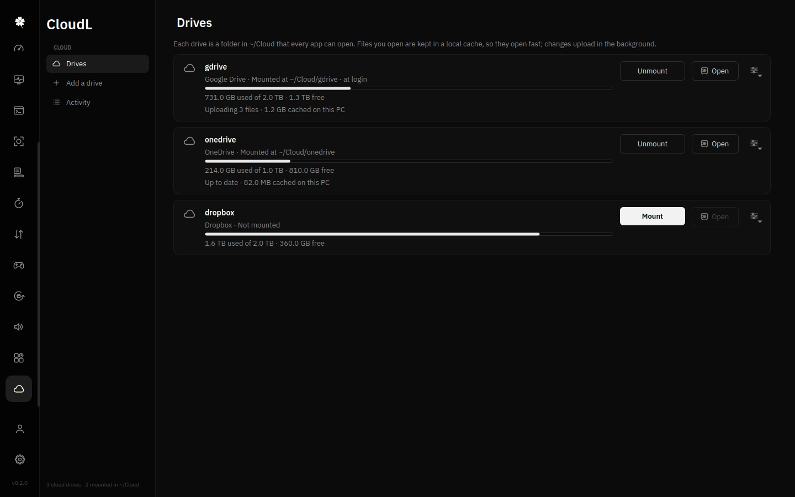

Your cloud drives as folders in `~/Cloud` that every app can open, through [rclone](https://rclone.org). **Add a
drive** runs rclone's own browser sign-in for Google Drive, OneDrive or Dropbox (any other rclone service can be set
up with `rclone config`, and shows up too); rclone keeps the key in its own config, which Grimoire never reads.
**Mount** starts a small per-user service (optionally at every login) with a local cache, so files open fast and
changes upload in the background. Each drive shows its space used and free and what is still uploading, **Open**
takes you there in VaultL (where mounted drives are listed under Drives), and **Activity** shows the mount's log and
errors. Plasma's own kio-gdrive (`gdrive:/` in Dolphin) is an alternative for Google Drive alone.
### ViewL: an image viewer and organizer

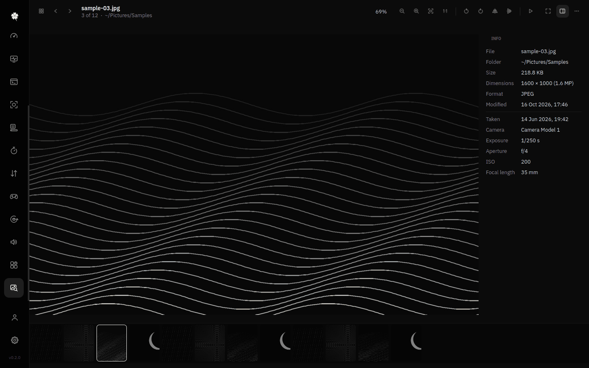

Gwenview's job in black and white: a folder of pictures as a fast thumbnail grid (made on worker threads and kept in
the same thumbnail cache Dolphin and Gwenview use), then each picture full size with a strip of its neighbours. Fit,
100% and zoom at the pointer with the wheel or a touchpad pinch, pan, turn and flip (a JPEG is saved losslessly: only
its orientation tag changes; replacing a file asks first and sends the original to the Trash, and **Save as** never
overwrites), next/previous with the arrow keys, a slideshow, full screen, EXIF details, copy, rename, copy/move to a
folder, Trash, **Set as wallpaper** (through MuraL), **Mark up in ShotL** and **Show in VaultL**. It reads every
format Qt does, including AVIF, HEIF, JPEG XL, WebP and camera RAW with `kimageformat6-plugins`, and plays animated
GIF/WebP. `grimoire-viewl [picture|folder]` opens it there; once installed from its card it shows up under
**Open with** for pictures, without becoming the default.
### StoreL: install and remove apps

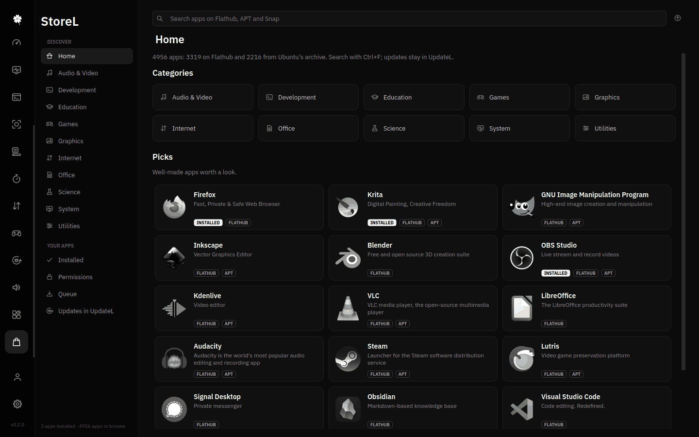

An app store in black and white, in place of Discover: Flathub and Ubuntu's archive (and the Snap Store when snapd is
installed) in one catalog read from the AppStream data already on your PC, with hand-picked apps, ten categories and
one search across every source. An app's page has its screenshots (the only colour in StoreL), description, size and
license, and lets you pick where to get it when it's in several places, and whether a Flatpak is just for you (no
password) or for everyone. Every APT install or removal is simulated first and shows everything that would be
installed and removed; removing the desktop, its fonts or required system packages is refused. Changes run in a queue
with progress, one password prompt per batch. Installed lists what you can remove (never essential packages), and
Permissions does Flatseal's job: each Flatpak's sandbox as switches you can override and reset. Updates stay in UpdateL.
### ReadL: a quiet PDF and ebook reader

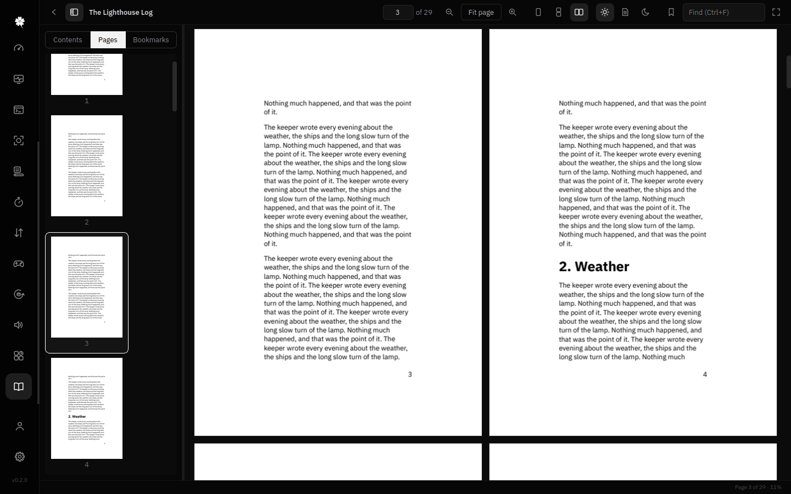

PDFs, EPUB books, Markdown and plain text in one distraction-free reader. A library of what you read lately with
covers and how far you got, and every file opens where you left it. Table of contents, page thumbnails, search
across the whole document, bookmarks, text selection and copy, fit width / fit page / any zoom, one page,
continuous or two pages side by side, and **Night** (inverted) or **Paper** (soft gray) pages. Books reflow in a
centered column in a serif or sans font at any size. F11 reads fullscreen; everything has a key (Ctrl+F, Ctrl+G,
Ctrl+B, F9, Ctrl+1/2/3, Ctrl+I). It shows up in "Open with" for PDFs, EPUBs and Markdown without taking over
from Okular; pick it as the default in Dolphin's Properties → File Type Options if you like it. EPUBs are read
defensively: nothing in a book can run, reach the network or read other files. PDFs need QtPdf
(`sudo apt install python3-pyside6.qtpdf`); without it ReadL shows that command and still reads everything else.
### PhoneL: your phone on this PC

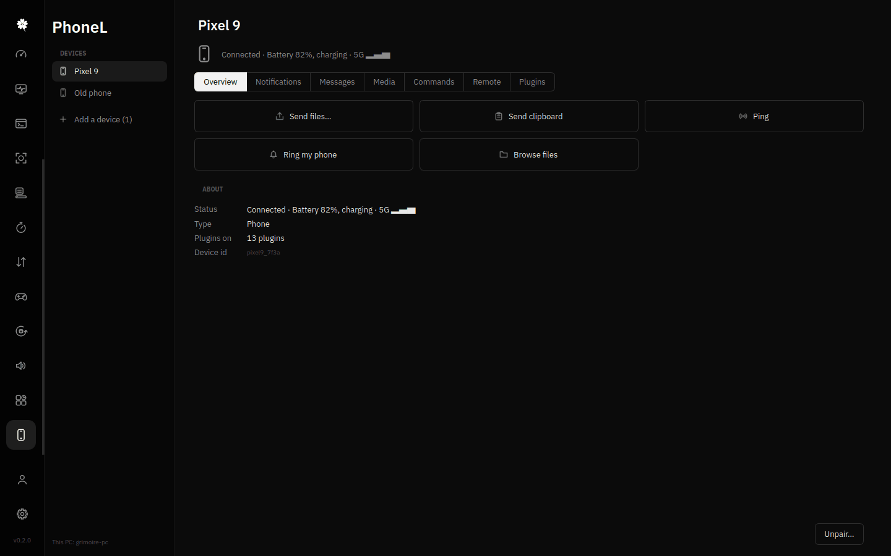

A black & white face on KDE Connect, in place of its own app: your paired phones and tablets with their battery and
signal, **Send files** (or drop them on the page), **Send clipboard**, **Ping**, **Ring my phone**, and **Browse
files**, which opens the phone's storage in VaultL. Per device: its notifications (reply where the app allows it,
dismiss one or all), text messages (conversations, replies and new messages, each confirmed before it goes out),
the music or video playing on it, commands set up on it, typing and a touchpad for its pointer, and which plugins are
on. **Add a device** lists phones asking to pair or nearby, with the key to compare, and how to get the app. Needs
KDE Connect (`sudo apt install kdeconnect`) and its phone app (Google Play, F-Droid or the App Store), on the same
network.
### NoteL: Markdown notes and a text editor

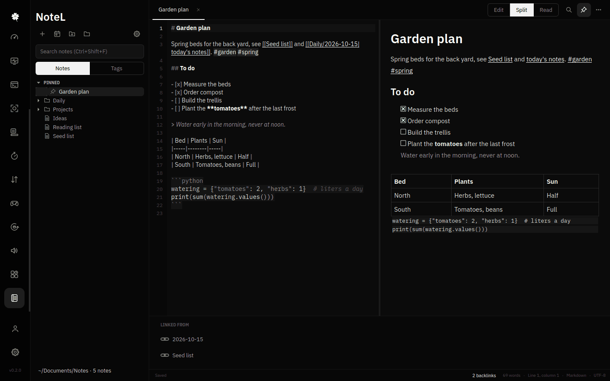

Your notes as plain Markdown files in a folder (`~/Documents/Notes` by default, or any folder you pick; an existing
Obsidian vault works as is): folders and pinned notes in the sidebar, fast full-text search, #tags and [[wiki links]]
with backlinks, a live preview beside the editor or on its own, tabs, find and replace, a daily note and export to
PDF or HTML. Notes save as you type, atomically, and a file another program changed is never overwritten: you choose
to reload theirs, keep yours or keep both. It also opens any text file (`grimoire-notel file…`, or **Open with** in
VaultL and Dolphin) with line numbers and black & white syntax colors for Python, shell, JSON, YAML, INI/TOML,
Markdown and C-like languages. The preview never loads remote images and links open only when you click them.

### Tray, Settings and updates


- **Tray icon** (`grimoire-tray`): live CPU/RAM bars in the system tray, with the crosshair, the next crosshair,
  "Tidy Downloads now", Performance mode and every spell in its menu. Optional start at login.
- **Settings** (the gear at the foot of the rail): every Grimoire hotkey in one list (written to KDE's own shortcut
  service, conflicts refused); **Backup & restore** of all settings in one `.grimoire-backup` file, with a preview
  of what would change and a safety backup first; **GitHub** sign-in to keep that backup in a secret gist and
  restore it on another PC; open at login and update checks.
- **Share setup** (Settings → Share setup): your whole look in one `.grimoire-setup` file or a short `GS1-` code:
  MuraL's screens and wallpaper playlist (pictures optional), your crosshair and its profiles, terminal profiles,
  LaunchL's favorites order and the tray meter. Community themes travel as store links you download on click. It
  refuses to save anything personal (your home path, user name, computer name, emails) and never includes accounts,
  tidy rules, history or terminal commands. Opening one shows what would change, spell by spell, keeps a safety
  backup, saves the look under MuraL → Looks and only changes your desktop when you press **Apply the look now**.
- **Printers** (Settings → Printers): your CUPS printers with their state (paper, toner, paused), the print queue
  with Cancel, set the default, pause/resume, print a test page and remove a printer (with a confirmation). **Add
  printer…** opens KDE's printer settings, which find drivers. Needs `python3-cups` (the panel shows the command).
- **About this PC** (on the home page, under the spells): CPU, graphics, memory, storage, system, kernel, Plasma,
  display, uptime and Grimoire's version, fastfetch-style, with **Copy** for a plain-text summary. Host and user
  names stay out unless you tick the box.
- **Self-update**: Grimoire checks GitHub every few hours. When there's something new, **What's new** lists the
  changes, **Update now** installs them and **Restart now** reloads. Or run `grimoire update`.


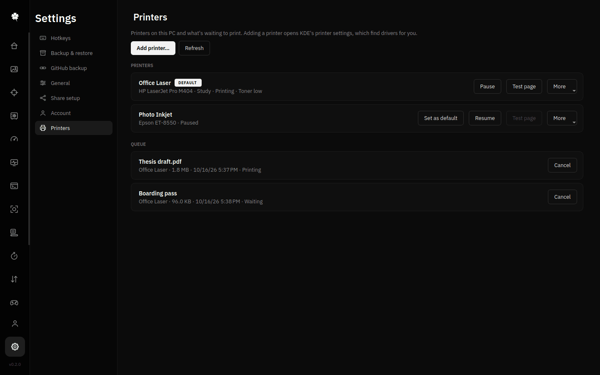

### Accounts, guest mode and first-run setup

- **Sign in or continue as a guest.** On first start Grimoire Linux shows its own sign-in screen: a username and
  password (email optional), or Google / GitHub. Your settings then follow you to every PC you sign in on; each
  account on a PC has its own settings. **Continue as Guest** (right under the form) works fully offline; guest
  settings are cleared at the next guest start, and **Create account to keep them** carries them over.
- **Forgot your password?** Username accounts get a one-time recovery code at sign-up; it sets a new password and
  gives you a fresh code.
- **First-run setup:** pick which spells show, optionally put back a saved MuraL look, check the hotkeys and choose
  a language. Run it again from Settings → General.
- Accounts run on a Supabase project (see [supabase/README.md](supabase/README.md)); until one is set up, the
  sign-in screen offers Guest. Threat model: [docs/security.md](docs/security.md).

### Languages

Grimoire Linux speaks English, 中文（简体） (Simplified Chinese), हिन्दी (Hindi), Español (Spanish), Français
(French), العربية (Arabic), বাংলা (Bengali), Português (Brazilian Portuguese), Русский (Russian) and اردو (Urdu).
Pick one in the first-run setup or in Settings → General (it applies after a restart). Arabic and Urdu lay the app
out right to left; Urdu headings use Nastaliq. Text in these scripts needs the Noto fonts (`fonts-noto-core`,
`fonts-noto-cjk`; already on Kubuntu).

The translations are machine-made, so some wording will be off. Native speakers are very welcome to fix them: edit
`translations/<area>/<lang>.ts` (`core` is the hub, Settings and sign-in; every spell has its own area) with Qt
Linguist or any text editor, run `python3 scripts/i18n.py release <area>` (needs `qt6-l10n-tools`) and open a pull
request. `python3 scripts/i18n.py stats` shows what is still untranslated.

## Install

### From source (recommended)

```bash
git clone https://github.com/cookedaj/grimoire-linux.git
cd grimoire-linux
./install.sh          # add --all to put every spell in the app menu too
grimoire              # or open "Grimoire Linux" from the app menu
```

The installer copies the app into `~/.local/share/grimoire/app`, links the commands into `~/.local/bin`, adds the
menu entries and copies the MuraL wallpaper plugin and LaunchL widget into Plasma. Everything runs from that copy,
so you can move or delete the download afterwards. If `grimoire` isn't found in a terminal, add `~/.local/bin` to
your `PATH` (or log out and back in). A ZIP download from GitHub works the same way.

The four small root helpers (login/boot themes, system tweaks, root actions in SystemL, FocusL's site blocking) are
the one exception to "everything per user": the installer asks for your password once to put them, root-owned, in
`/usr/local/libexec/grimoire-linux`, so nothing running as you can change what runs as root. It asks again only when
a newer version changes them; `./install.sh --no-system` skips this (those features then stay unavailable).

### Packages

- **Debian / Ubuntu / Kubuntu (.deb)**: coming soon on the
  [Releases page](https://github.com/cookedaj/grimoire-linux/releases); then
  `sudo apt install ./grimoire-linux_*_all.deb`.
- **Arch / Manjaro / EndeavourOS (AUR)**: coming soon as `grimoire-linux-git` (`yay -S grimoire-linux-git`).

Packages install system-wide into `/usr/share/grimoire-linux` (root helpers in `/usr/libexec/grimoire-linux`) and
update with your system; the in-app updater is off there.

### Requirements

KDE Plasma 6 (Wayland is best; made on Kubuntu 26.04) and Python 3.12+ with PySide6, Pillow and psutil, plus
layer-shell-qt (SightsL), Qt Multimedia (video wallpapers), pyte (TerminalL), QtPdf (ReadL) and dbus-python (GitHub sign-in).
Optional: ffmpeg (video thumbnails, recordings), Spectacle (ShotL), NetworkManager (NetL controls), PipeWire's
`pw-dump`/`wpctl` (AudioL; on every Plasma 6 system), rclone and fuse3 (CloudL), rsync.

```bash
# Ubuntu / Kubuntu / Debian
sudo apt install python3-pyside6.{qtcore,qtgui,qtwidgets,qtsvg,qtdbus,qtnetwork,qtqml,qtquick,qtpdf} python3-pil \
    python3-psutil python3-pyte python3-dbus qml6-module-org-kde-layershell qml6-module-qtmultimedia ffmpeg rsync
# Fedora
sudo dnf install python3-pyside6 python3-pillow python3-psutil python3-pyte python3-dbus layer-shell-qt \
    qt6-qtmultimedia ffmpeg-free rsync
# Arch / Manjaro / EndeavourOS
sudo pacman -S pyside6 python-pillow python-psutil python-pyte python-dbus layer-shell-qt qt6-multimedia ffmpeg rsync
```

### Every spell as its own app

Press **Install** on a spell's card on the home page (or `./install.sh --all`), or run `grimoire-mural`,
`grimoire-sightc`, `grimoire-vaultl`, `grimoire-optimizel`, `grimoire-systeml`, `grimoire-terminall`,
`grimoire-shotl`, `grimoire-focusl`, `grimoire-netl`, `grimoire-gamel` or `grimoire-audiol` directly. Command-line helpers:
`grimoire-shotl`, `grimoire-focusl`, `grimoire-netl`, `grimoire-widgetl` or `grimoire-cloudl` directly. Command-line helpers:
`grimoire-shotl`, `grimoire-focusl`, `grimoire-netl`, `grimoire-gamel`, `grimoire-audiol` or `grimoire-phonel`
directly. Command-line helpers:
`grimoire-shotl`, `grimoire-focusl`, `grimoire-netl` or `grimoire-widgetl` directly. Command-line helpers:
`grimoire-sightc on|off|toggle|next`, `grimoire-vaultl [folder]`, `grimoire-vaultl tidy run|undo|enable|disable|status`,
`grimoire-systeml alerts check|enable|disable|status`, `grimoire-focusl start|stop|status`,
`grimoire-gamel list|status|play <launcher:id>`, `grimoire-updatel check|enable|disable|status`,
`grimoire-notel [file…]|--daily`, `grimoire update`.

To make VaultL the default file manager: `xdg-mime default grimoire-vaultl.desktop inode/directory` (switch back in
System Settings → Default Applications).
To make ViewL the default image viewer, pick it in System Settings → Default Applications (or
`xdg-mime default grimoire-viewl.desktop image/jpeg image/png image/webp image/gif`).

## Uninstall

```bash
~/.local/share/grimoire/app/uninstall.sh            # keeps your settings for a later install
~/.local/share/grimoire/app/uninstall.sh --purge    # also moves settings, logs and cache to the Trash
```

It removes the app, commands, menu entries, the wallpaper plugin (switching your desktop to MuraL's current picture first),
LaunchL (putting Kickoff back first), WidgetL's widgets (taking them off the desktop first), the timers, the autostart entries and the root helpers in
`/usr/local/libexec/grimoire-linux` (one password prompt). Looks and tweaks you applied stay as
they are, so turn off MuraL themes and OptimizeL switches first if you want them undone. With a package, run
`/usr/share/grimoire-linux/uninstall.sh` as yourself, then remove the package.

## FAQ

### Is it safe?

Grimoire runs as you. The few things that change the system (login and boot themes, system tweaks, other users'
processes, focus-time site blocking) ask for your password through KDE's own prompt and go through small helper
scripts that only know a fixed list of actions, check every argument and keep the old values so you can undo.
Your files are never deleted: they go to the Trash, and name clashes become "name (2)". Community themes are only
downloaded when you press Install, and archives are unpacked defensively. Details: [docs/security.md](docs/security.md).

### What needs root, and why?

Only what lives outside your home: the SDDM login theme and Plymouth boot animation (MuraL), system-wide tweaks such
as sysctl, zram and services (OptimizeL), acting on system services or other users' processes (SystemL), and
`/etc/hosts` for blocking sites while you focus (FocusL), system updates (UpdateL) and installing or removing
system apps (StoreL; your own Flatpaks need no password). Each asks at the moment you do it, never in the background.

### Does it work on X11 or GNOME?

Grimoire Linux is built for **KDE Plasma 6 on Wayland**, and that's where it's tested. Most windows open on Plasma's
X11 session too, but the crosshair overlay needs Wayland's layer-shell, and MuraL, LaunchL, hotkeys and the tray
speak to Plasma directly. On GNOME or other desktops much of it won't do anything useful; it isn't a goal for now.

### How do updates work?

A source install checks GitHub every few hours (turn it off in Settings → General or with
`GRIMOIRE_NO_UPDATE_CHECK=1`) and shows what changed before installing; your settings, timers and autostart are kept.
`git pull && ./install.sh` works too. Packages update through apt or pacman.

### What about privacy?

No telemetry, no analytics, and Guest mode needs no account. The app only goes online when you ask (community store, NetL's
public-IP and ping checks, UpdateL's Check now and changelogs, StoreL's app sizes, screenshots and Snap search,
GitHub backup, your account's sign-in and settings sync)
and for the update check, which is one request to GitHub's public API.

### How do I uninstall?

See [Uninstall](#uninstall): one command, and `--purge` if you want your settings gone too (to the Trash).

## Documentation

- [How it works](docs/how-it-works.md): where each spell keeps its settings, what it changes and how to undo it,
  plus the code layout
- [Security and privacy](docs/security.md): root helpers, network use, the GitHub sign-in threat model

## Contributing

Issues and pull requests are welcome at [github.com/cookedaj/grimoire-linux](https://github.com/cookedaj/grimoire-linux).
Keep the look strictly black & white (no accent colors; new icons are line glyphs drawn in `grimoire/glyphs.py`),
keep modules small, never delete user files (Trash only), and send anything that needs root through a spell's
whitelisted `root-helper.sh` (run only from its root-owned system copy, see
`grimoire/roothelper.py`). Test UI offscreen (`QT_QPA_PLATFORM=offscreen`) and file operations in a sandbox
folder. `python3 scripts/screenshots.py` regenerates the screenshots; `scripts/release.sh X.Y.Z` prepares a
release; `packaging/build-deb.sh` builds the .deb.

## License

Copyright (C) 2026 cookedaj

Grimoire Linux is free software: you can redistribute it and/or modify it under the terms of the GNU General Public
License as published by the Free Software Foundation, either version 3 of the License, or (at your option) any later
version. See [LICENSE](LICENSE). Files adapted from KDE projects, if any are added, keep their original copyright
and license headers. Wallpapers and community themes you install belong to their creators and aren't part of this
repository.
